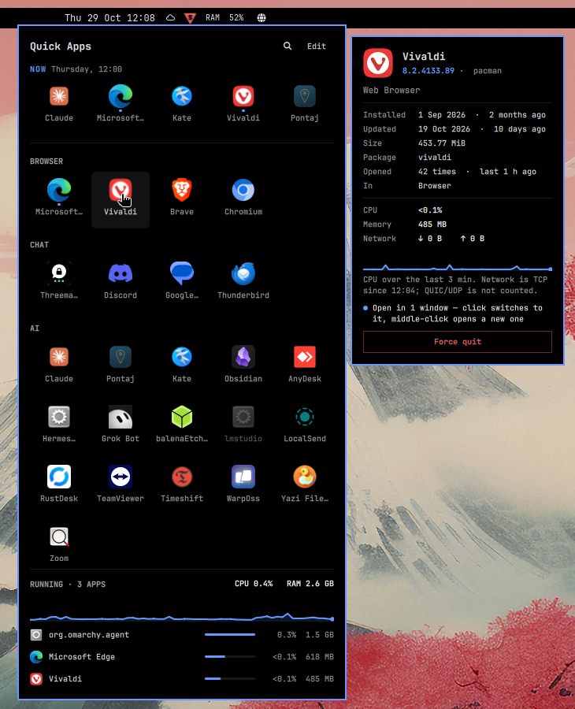
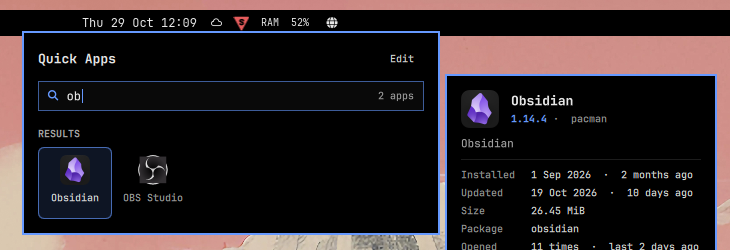
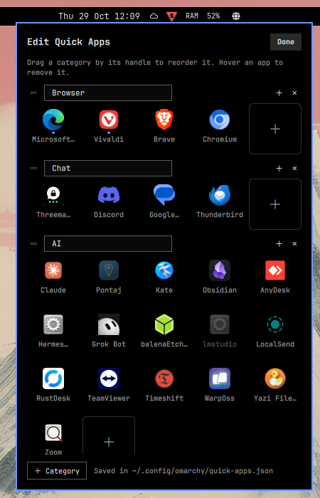
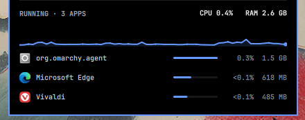
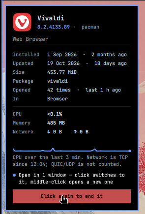

# Quick Apps

A quiet launcher in the Omarchy bar: the applications you actually use, in
your own categories, one hover away. It draws in your theme's two colours and
nothing else, learns which applications you reach for at each hour of the day,
switches to what is already open instead of opening it twice, and tells you
what any application is — version, install date, last update — when you rest
the pointer on it.



## What it does

One small icon in the bar. Rest the pointer on it and a panel drops down with
your applications as icon tiles, under headings you name yourself ("Browser",
"Work", "Games" — whatever you keep going back to). Click a tile, and the panel
is gone.

- **Two colours, both your theme's.** Text in the theme's popup colour, and the
  accent for the few things that are live or chosen. Switch Omarchy themes and
  the panel follows; nothing in it names a colour of its own.
- **Now.** The row on top is not "most used ever" — it is what you are most
  likely to want *at this hour*. Every launch is filed by hour of day and day
  of week, so the browser you open at 9:00 and the music player you open at
  20:00 each surface at their time. From the keyboard, `1`–`9` launch the row
  without moving the cursor.
- **Open is marked, and a click goes there.** An application that already has
  a window carries a short accent bar under its icon — a dot for one window, a
  longer bar for several. Clicking it switches to that window instead of
  starting a second copy; with several windows, each click moves to the next.
  Middle-click (or `Shift+Enter`) always opens a new one.
- **Details on hover.** Rest on a tile and a card slides out beside the panel:
  version, where it came from (pacman, Flatpak, web app, AppImage), when it was
  first installed, when it was last updated, size, package, how often you open
  it and when you last did.
- **What open apps cost.** A small section at the bottom of the panel: total
  CPU and memory of everything open, a three-minute CPU line, and the heaviest
  applications by name. Each one's details card adds its own CPU, memory, TCP
  traffic and CPU line — and a **Force quit** button for when it hangs.
- **Search that finds what you meant.** Type to search, and the answer is first
  where `Enter` takes it: `fir` → Firefox, `code` → Visual Studio Code, `vsc` →
  Visual Studio Code by its initials, `obsd` → Obsidian. It reaches past your
  categories into everything installed, so a search never dead-ends on an
  application you have not filed yet.
- **Edit in place.** **Edit** turns on add, remove, rename and drag-to-reorder
  right in the panel; the file behind it is plain JSON if you would rather.

## Requirements

| | |
|---|---|
| **Omarchy** | 4.x (the Quickshell `omarchy-shell`) |
| **Applications** | Anything with a `.desktop` entry — the panel reads the same application index as the Omarchy menu |

No daemon, no extra packages, nothing to enable. The details card asks `pacman`
(and `flatpak`, when an entry comes from it) for package facts, which are on
every Omarchy system already.

## Install

```bash
omarchy plugin add https://github.com/samara-hub-ro/samara-quick-apps.git --enable --yes
```

Plugins run as unsandboxed code inside `omarchy-shell`. Drop `--enable --yes` to
review the source before enabling it:

```bash
omarchy plugin add https://github.com/samara-hub-ro/samara-quick-apps.git
# review ~/.config/omarchy/plugins/samara-hub-ro.quick-apps/
omarchy plugin enable samara-hub-ro.quick-apps --section center
```

It lands in the bar's centre section. Move it with:

```bash
omarchy bar move samara-hub-ro.quick-apps --section right
```

Updating and removal are the usual commands:

```bash
omarchy plugin update samara-hub-ro.quick-apps
omarchy plugin remove samara-hub-ro.quick-apps
```

> **Bar widgets need a full shell restart to re-instantiate.**
> `omarchy-shell shell rescanPlugins` reloads plugin *code*, but live bar
> widgets keep their existing instances. After installing or hacking on this
> plugin, run `omarchy restart shell` if the bar looks unchanged.

## Using it

**Bar icon**

| Action | Result |
|---|---|
| Hover | Open the panel (after `hoverOpenDelay`) |
| Left click | Open / close it |
| Right click | Open it straight into edit mode |

Moving the pointer off both the icon and the panel closes it again after
`hoverCloseDelay`, which is there so crossing the gap between the two does not
snap it shut. A panel you are editing never closes on its own.

**Panel**

| Action | Result |
|---|---|
| Click a tile | Launch it — or, if it is already open, switch to its window |
| Middle-click a tile | Always open a new window |
| Rest on a tile | The details card slides out beside the panel |
| Search icon (top right) | Hand the panel the keyboard, to search without the shortcut |
| **Edit** | Add, remove, rename and reorder |

**Keyboard**, once the panel is open from the keybinding (a hover open leaves
the keyboard where it was; the search button or **Edit** claims it):

| Key | Result |
|---|---|
| `1`–`9` | Launch that application from the now row |
| Any letter | Search everything installed; `Backspace` deletes, `Esc` clears |
| `←` `→` `↑` `↓` | Move between tiles; the details card follows the cursor |
| `Enter` | Launch the selected application, or switch to it if it is open |
| `Shift+Enter` | Always open a new window |
| `Tab` | Move to the neighbouring bar panel |
| `Esc` | Close |

A pointer-opened panel deliberately does **not** take the keyboard, so passing
the pointer over the bar never swallows a keystroke from whatever you were
typing in.



**Editing.** Hit **Edit** and every category grows a handle on its left — press
it and drag; an insertion line shows where it will land, and the move is
committed when you let go. Rename a category in place, `＋` adds an application
to it, `✕` deletes it; on each tile `✕` removes it and, with the usage sort
off, `‹ ›` reorder it. **＋ Category** adds a group. Adding an application opens
a searchable list of everything installed; the ones already in that category
are marked and inert, so you can add several in a row.



## Now: the rhythm row

Every launch lands in two small histograms per application — one by hour of
day, one by day of week. When the panel opens, each application is scored for
*this moment*: the hour histogram is read through a soft window two or three
hours wide (so a habit at 9:00 still counts at 8:50), scaled by how much
today's weekday favours that application once there are at least a week's
worth of launches, plus a small share of the all-time count as a tie-breaker.

That last part is also what fills the row on day one, and on an upgrade from
1.x — counts carried over from before still rank, and the rhythm sharpens from
there. Switching to an application that is already open is not a launch, and
does not move its count, but it does teach the rhythm: "I wanted this, now" is
exactly what the row is for.

The row never wraps (it is capped by `columns`), and it hides while you edit or
search. `suggestionCount` sets its length; `showSuggestions` turns it off.

There is also an IPC call to launch from it without opening anything, which
makes "the app I want right now" a single keybinding:

```bash
omarchy-shell samara-hub-ro.quick-apps launchSuggestion 1
```

## The details card

Resting on a tile for `detailsDelay` (450 ms) slides the card out beside the
panel, on whichever side has room. Once it is up, moving to another tile
retargets it at once. The keyboard cursor gets it too.

| Row | Where it comes from |
|---|---|
| Version | `pacman -Qi` (package release suffix trimmed), or `flatpak info` |
| Installed | The first `installed` line for that package in `/var/log/pacman.log`; for a local entry, when the `.desktop` file arrived |
| Updated | pacman's *Install Date* — when the version on disk went in; for a local entry, the file's last change |
| Size, Package | `pacman -Qi` |
| Opens | For an Omarchy web app, the address it opens |
| Opened | This launcher's own count and last launch |
| In | The category it is filed under |

An entry in `~/.local/share/applications` that overrides or wraps a packaged
program (a hand-tuned `.desktop` for Kate, say) is traced to the package that
owns the binary in its `Exec` line, so it still shows a real version. Rows with
nothing to say are left out rather than shown as a dash.

The lookup is `appinfo.sh`, run once per application per shell session, one at
a time, under a timeout, with a clean environment; the desktop id is passed as
an argument and only ever used as a file name inside the XDG application
directories. Turn the card off with `showDetails`.

## What open apps cost

The **Running** section at the bottom of the panel shows, for everything that
has a window open:



- **Totals** — CPU and memory of all of them together.
- **A CPU line** over the last three minutes, one sample every 3 seconds.
- **The heaviest few** by name, CPU first, with a bar for each one's memory
  against the largest. Hover one of your own applications for its details
  card; click it to switch to it.

Numbers are per **application**, not per process. Omarchy starts every
application in its own systemd scope, and the monitor reads that scope's
cgroup counters — so a browser's memory is the browser with every renderer and
helper process, which is the number that actually matters. A window whose
process is not in an application scope is measured from that one process.
CPU is a share of the whole machine: 100% means every core busy.

In the details card of an open application:

| Row | What it is |
|---|---|
| CPU, Memory | Its share right now, as above |
| Network | Bytes received ↓ and sent ↑ over **TCP** since the monitor first saw it |
| CPU line | Its own last three minutes |

**About the network figure.** Linux gives an unprivileged user per-socket byte
counters for TCP only. UDP — and with it QUIC, which browsers use for much of
their traffic (YouTube, Google services, many CDNs) — has none without root, so
it is not in the number, and the card says so. A browser can show close to
zero while streaming video. The count covers every TCP connection the monitor
saw alive, in full, including ones opened before it started; a connection that
opens and closes between two samples is missed. It is a floor, not a meter.

Sampling continues in the background while the panel is shut, so connections
are seen while they are alive. One sample is a `hyprctl clients`, a read of a
few cgroup files and an `ss -tinp` — about 50 ms of work every 3 seconds. Turn
all of it off with `showMonitor`.

### Force quit



The card of an open application ends with **Force quit**. It takes two clicks:
the first arms it (it turns solid and says *Click again to end it*, and
disarms itself after a few seconds), the second sends **SIGTERM** to every
process in the application's scope, so it can still save and exit cleanly. If
a window is still there three seconds later — a truly hung application — the
button offers **SIGKILL**, which goes through the scope's `cgroup.kill` and
takes the whole tree at once.

`killapp.sh` checks its target itself rather than trusting the panel: only a
scope under your own `app.slice`, or a single process you own. Hyprland and the
shell live in `session.slice`, so there is no value that can take the desktop
down with the application.

To reach the button, move onto the card: while the pointer is travelling from
its tile toward the card, the card does not jump to the other tiles it passes
(the "safe triangle" of nested menus). Resting on another tile does move it.

## Counting what you open

Every application in the launcher carries a count of how many times you have
opened it — shown in its details card, and behind the now row and the usage
sort. Opening it from the panel counts; so does opening it from a keybinding,
the Omarchy menu, a terminal or any other launcher.

The counter is worth being precise about, because it is exact in some places and
an inference in others:

- It counts **from the moment the application was added to a category**, not
  from when you installed it and not from when you installed this plugin. `18`
  means "eighteen times since you put this here".
- Taking an application out of a category **forgets its count**. Put it back and
  it starts from zero, because by the rule above that is what its count now
  means.
- A launch **from the panel** — a tile clicked, a now-row key, `Enter` on the
  keyboard cursor — is counted directly and exactly once. This is the part that
  is certain. Switching to a window that is already open is not a launch.
- A launch **from anywhere else** is inferred from a window appearing, because
  nothing on the system announces that an application was started. That
  inference is good but not perfect:
  - It counts **windows**. An application that reuses a window it already has —
    a browser opening a link in a tab, a single-instance editor opening a file
    — has not opened a window and will not move. Opening a *second* window of
    something already running does count.
  - It has to **recognise the window**. A window whose class matches no entry in
    your launcher counts for nobody, and one that matches *two* also counts for
    nobody: crediting the wrong application is worse than not counting, since
    you would have no way to notice and no way to correct it.
  - Two windows of the same application inside 1.5 seconds count **once**, which
    is nearly always a splash screen rather than you opening two.
  - Windows already open when the shell starts are **not** launches.
- Set `countExternalLaunches` to `false` to go back to counting only what you
  launch from the panel.

The same window-class rules decide which applications are marked as open — and
refuse to mark one when a window could belong to two.

Counts live in `~/.config/omarchy/quick-apps-usage.json`, beside the categories
rather than inside them: they change on every launch, and rewriting the file you
hand-edit once per launch is a good way to lose a hand edit.

```json
{
  "version": 1,
  "apps": {
    "brave-browser": {
      "count": 18,
      "since": "2026-09-03T09:22:31.778Z",
      "last": "2026-10-29T09:04:02.331Z",
      "hours": [0,0,0,0,0,0,0,1,4,6,3,1,0,0,1,1,0,0,0,1,0,0,0,0],
      "days": [1,4,3,3,4,3,0]
    }
  }
}
```

`hours` is local hour 0–23, `days` is Sunday first. A file written by 1.x has
neither; they start at zero and fill from the first launch.

To wipe the slate without touching your categories:

```bash
omarchy-shell samara-hub-ro.quick-apps resetCounts
```

### Sorting by what you use

Each category orders its tiles most-launched first. It is a view over the
counts, not a rewrite: the order in `quick-apps.json` stays exactly as you
arranged it, applications you have never opened keep that order among
themselves, and turning `sortByUsage` off puts everything straight back.

While the sort is on, the per-tile `‹ ›` buttons are hidden. The order is
derived at that point, so a move button could only lie about what it does —
turn the sort off if you want to arrange tiles by hand.

## The bar mark

The icon in the bar is a downward-pointing triangle with an S cut out of it —
the triangle for the panel it drops, the S for samara. It is painted rather
than shipped as an image, so it takes the bar's own colour and its active tint,
and stays crisp at whatever height your bar happens to be.

To use a glyph instead, put one in `icon`. An empty `icon` means the drawn mark.

## Colours

There are two, and both come from the active Omarchy theme:

- **Popup text** (`Color.popups.text`) for everything at rest — names, headings
  (dimmed), icons' surroundings, hover fills (a thin wash of the same colour).
- **Accent** (`Color.accent`) for what is live or chosen, and nothing else: the
  open-window marker, the keyboard cursor, the search caret, the `NOW` label,
  the version in the details card, the drag insertion line.

The panel background and border are the theme's popup surface, exactly as the
first-party panels draw them. Change theme and every one of these follows
immediately — there is no colour setting, because there is nothing to set.

Categories used to carry their own colours in 1.x. A `color` already in
`quick-apps.json` is kept in the file untouched, so going back to 1.x loses
nothing, but 2.0 does not draw it.

## A keybinding

Nothing is bound by default — pick a free key in `~/.config/hypr/bindings.lua`:

```lua
o.bind("SUPER + A", "Quick Apps", "omarchy-shell samara-hub-ro.quick-apps toggle")
o.bind("SUPER + SHIFT + A", "Quick Apps: now", "omarchy-shell samara-hub-ro.quick-apps launchSuggestion 1")
```

`toggle`, `open`, `close`, `show`, `hide`, `edit`, `launchSuggestion <n>` and
`resetCounts` are all accepted — `edit` opens straight into the editor, which
is worth a binding if you rearrange often.

On a multi-monitor setup the widget exists once per bar, and IPC reaches the
first one that registered — the same way Omarchy's own panels behave.

## Settings

Configured per bar entry in `~/.config/omarchy/shell.json`, or through Omarchy's
plugin settings UI, which builds a form from the manifest schema.

| Key | Type | Default | What it does |
|---|---|---|---|
| `openOnHover` | boolean | `true` | Open the panel when the pointer rests on the icon |
| `hoverOpenDelay` | integer (ms) | `140` | How long the pointer has to stay before it opens |
| `hoverCloseDelay` | integer (ms) | `280` | Grace period after the pointer leaves both icon and panel |
| `columns` | integer | `5` | Tiles per row — this is what sets the panel's width |
| `iconSize` | integer (px) | `30` | Size of each application icon |
| `showLabels` | boolean | `true` | Print application names under the icons |
| `maxHeight` | integer (px) | `520` | Height at which the category grid starts scrolling instead of growing. The now row sits above it and is not charged against this |
| `backgroundOpacity` | integer (%) | `100` | Opacity of the panel and details card. `100` is your theme exactly |
| `showSuggestions` | boolean | `true` | Show the now row |
| `suggestionCount` | integer | `5` | How many applications the now row shows (1–8, and never more than `columns`) |
| `showRunning` | boolean | `true` | Mark applications that already have a window open |
| `focusRunning` | boolean | `true` | Clicking an open application switches to it instead of opening another |
| `showMonitor` | boolean | `true` | The Running section, the live rows and Force quit in the details card, and the background sampling behind them |
| `showDetails` | boolean | `true` | Show the details card on hover |
| `detailsDelay` | integer (ms) | `450` | How long to rest on a tile before its details card appears |
| `sortByUsage` | boolean | `true` | Order the tiles in each category most-launched first |
| `countExternalLaunches` | boolean | `true` | Also count applications opened from a keybinding, the Omarchy menu or a terminal |
| `seedOnFirstRun` | boolean | `true` | Fill the categories from installed applications the first time |
| `icon` | string | *(empty)* | Glyph shown in the bar; empty means the drawn mark |
| `configPath` | string | *(empty)* | Name of the categories file **inside `~/.config/omarchy/`** — `work.json`, say. Empty means `quick-apps.json`. Anything that is not a plain `.json` name in that directory is ignored and the default is used |

Settings removed in 2.0 — `showMostUsed`, `mostUsedCount`, `showUsageChart`,
`showLaunchCounts`, `countIcon`, `categoryTint` — are simply ignored if they are
still in `shell.json`.

Both files stay inside `~/.config/omarchy/`. `configPath` names one of them; it
does not point anywhere, so there is no path for a stray value to escape down
and no way for the counts to be written over the categories.

```jsonc
{
  "id": "samara-hub-ro.quick-apps",
  "columns": 6,
  "iconSize": 40,
  "showLabels": false,
  "suggestionCount": 6,
  "detailsDelay": 250
}
```

## The categories file

Your applications are **not** kept in `shell.json` — they are content rather
than configuration, and the panel rewrites them every time you add or remove a
tile. They live in `~/.config/omarchy/quick-apps.json`:

```json
{
  "version": 1,
  "categories": [
    { "id": "internet", "name": "Internet", "color": "",        "apps": ["brave-browser", "chromium"] },
    { "id": "work",     "name": "Work",     "color": "#a78bfa", "apps": ["obsidian", "slack"] }
  ]
}
```

`apps` holds desktop-entry ids — the `.desktop` filename without its extension.
`color` is a 1.x leftover — kept in the file if it is there, not drawn by 2.0.
The order of the list is the order you arranged, which is what the panel shows
with `sortByUsage` off — with it on, the panel sorts that list by launch count
for display without touching the file.
The file is watched, so editing it by hand updates the panel immediately, and
anything malformed in it is ignored rather than thrown away. An application
whose `.desktop` file has since disappeared keeps its tile, greyed out, so you
can see what to remove instead of wondering where it went.

The first time the panel opens with nothing in it, it builds a starting set from
the applications you have installed, bucketed by their own XDG categories
(Internet, Development, Media, Office, System). It is a starting point, not a
policy — rename it, regroup it, delete what you do not want. Turn
`seedOnFirstRun` off to start from an empty panel instead.

### What the panel will read

Both files are treated as input, not as something the panel wrote and can
therefore trust — you edit one of them by hand, and a file on disk is whatever
happens to be on disk. So there are ceilings, checked before anything is parsed,
cloned, sorted or drawn:

| | Limit |
|---|---|
| Either file, on disk | 256 KiB — a bigger one is ignored, and left where it is |
| Categories | 64 |
| Applications in a category | 256 |
| Applications in total | 1024 |
| Category name | 96 characters |
| Desktop-entry id | 255 characters |
| Any text taken from a `.desktop` file | 160 characters |
| Entries in the counts file | 4096 |

They are far above any launcher anyone builds by hand and far below anything
that costs the shell noticeable memory or a dropped frame. What goes over a
ceiling is dropped, not truncated into something else: an over-long id would
otherwise silently name a different application. The panel enforces the same
ceilings on what *it* writes, so a file it saved always reads back identically.

### How it reads them

Both files are read through `BoundedFile.qml`, not through `FileView`. A
`FileView` opens the path and materialises all of it before QML sees a byte, so
a size check on the result is not a boundary: a FIFO left in place of the file
blocks the read, and an oversized file is already in memory before anything can
reject it. QML has no syscall surface to fix that, so the boundary is produced
by two short-lived commands:

1. `stat -c '%F|%U|%s'` — `lstat`, so a symlink reports as `symbolic link` and a
   FIFO as `fifo`. Anything that is not a regular file is refused, as is a file
   owned by anyone but you, as is a size already over the ceiling.
2. `dd if=<path> iflag=nofollow,nonblock bs=<limit+1> count=1` — `O_NOFOLLOW`
   refuses a symlink at open time, `O_NONBLOCK` makes a FIFO return `EAGAIN`
   instead of blocking, and one read of at most `limit+1` bytes is all that can
   arrive. A file that grew past the ceiling between the two calls comes back
   one byte too long and is rejected on that.

Both run under `timeout`, with `PATH` pinned to `/usr/bin:/bin` and no shell,
and both are killed by a watchdog and when the widget goes away.

The `FileView` behind each file is kept for the two things that need no read:
writing it, and noticing when something else changes it. A file that is refused
is left exactly where it is — the panel keeps what it already had on screen and
writes nothing over it.

## Transparency

`backgroundOpacity` sets the panel's alpha over whatever is behind it; the
colour itself comes from your theme's `popups.background`, so the panel follows
a theme switch like every other Omarchy surface.

For a frosted panel rather than a plain translucent one, blur its layer in
Hyprland — the surface is namespaced `samara-quick-apps`:

```lua
hl.config({ decoration = { blur = { enabled = true } } })
hl.layer_rule({ match = { namespace = "samara-quick-apps" }, blur = true })
```

Omarchy ships with compositor blur off, so the first line is the price of the
second — it turns blur on for the whole desktop.

## How it works

**Hover without breaking hover.** A popup that opens on hover has an awkward
problem: Omarchy's keyboard-capable panel base claims the entire screen as its
input region, so the moment it opens, the bar stops seeing the pointer — the
icon "un-hovers" and the panel would close itself. This plugin ships its own
panel surface, adapted from `Ui/KeyboardPanel.qml`, whose input region is
narrowed to the card. The bar keeps its own hover, and the widget decides
"open" from the union of the icon's hover and the card's, with a delay on each
edge.

**Except when the keyboard is involved.** Hyprland hands keyboard focus back to
whatever is under the pointer the moment a layer surface steps down from its
focus grab, so a panel that wants to keep the keyboard has to be under the
pointer wherever the pointer is. When the panel is opened from the keybinding
(or a click), it takes the whole screen as its input region — which is also what
gives outside clicks something to land on for dismissal. Hover-opened, it stays
narrow and takes no keyboard focus at all.

**Counting launches nobody announces.** There is no signal anywhere for "an
application was started" — the shell's own `AppLibrary.launch` emits none, and
neither does anything else on the bus. What a Wayland compositor *does* announce
is a new window, so that is what the plugin watches, mapping the window's class
back to one of the entries in your launcher.

That mapping is the whole difficulty, and the rule that shapes it is: **when a
window looks like two different applications, credit neither.** A count quietly
attributed to the wrong application is worse than a count not taken, because you
have no way to notice the first and no way to correct it afterwards. The rules
live in `WindowMatch.js`, deliberately free of QML so they can be run against a
real machine's desktop entries and window classes. Four tiers, strongest first:
the entry's declared `StartupWMClass`; its id; the last segment of a reverse-DNS
id (`org.kde.kate` maps a window classed `kate`); and finally a comparison with
case and punctuation discarded (`LM-Studio` for "LM Studio"). Entries whose
`StartupWMClass` is still the packaging template `@@startup_wm_class` are read
as declaring nothing.

**Waiting out the compositor.** Every window that was already open reaches the
watcher as a new one when the shell connects, and that enumeration can land well
after the widget is built — so "ignore the first couple of seconds" does not
cover it. Instead the burst pushes the arming ahead of itself: each window seen
while unarmed restarts the timer, so counting begins only once the window list
has gone quiet, whenever that turns out to be.

**Sorting as a view, never as a write.** It would have been simpler to reorder
`quick-apps.json` every time a count changed, and much worse: the file would
churn on every launch, a hand-arranged order would be destroyed the first time
the sort was switched on, and turning it off again would have nothing to
restore. Sorting at render time costs one comparison per tile and keeps the
user's arrangement intact underneath it.

**Committing a drag on release.** The panel's categories come from a plain JS
array rebuilt on every config change, which re-creates the whole `Repeater` —
including the delegate holding the pressed pointer. Reordering live as you drag
would therefore end the drag on its first step. So the drop point is derived
from a geometry snapshot taken on press, drawn as an insertion line, and applied
once the button comes back up.

**Launching** goes through the shell's own application library when the running
bar exposes it, so it gets the same icon resolution and the same launch feedback
as the Omarchy menu, and falls back to the desktop entry's own launch path
otherwise. **Switching** to an open application goes through the Wayland
foreign-toplevel `activate` request, which Hyprland answers by focusing the
window and moving to its workspace.

**The details card** lives on the same layer surface as the panel. While it is
up, the surface's input region is the panel card *and* the details card, so
the pointer can move onto it and press Force quit without the panel reading
that as leaving.

## Troubleshooting

**The icon is not in the bar.** Confirm it is enabled and placed:
`omarchy plugin list | grep quick-apps`. Then `omarchy restart shell` —
`rescanPlugins` alone will not re-instantiate a bar widget.

**The panel does not open on hover.** Check `openOnHover` is on and that
`hoverOpenDelay` is not set higher than you expect. A click on the icon always
opens it regardless.

**The keybinding opens nothing.** Test the call directly:
`omarchy-shell samara-hub-ro.quick-apps toggle`. If that works, the binding is
the problem — `omarchy menu keybindings --print` shows what is registered.

**Typing does not search.** Typing only reaches a panel that owns the keyboard:
one opened from the keybinding, or one handed the keyboard with the search
button in its header. A hover or click open deliberately leaves the keyboard
alone.

**After launching something, hovering the icon did nothing until I clicked
(1.x).** Fixed in 2.0. Every close used to disarm hover until the pointer left
the icon — but after a launch from the panel the pointer was never on the icon,
so the re-arm never came. Hover now stays armed unless the panel was closed
with the pointer on the icon itself.

**The details card shows no version.** The entry is not owned by a package and
its `Exec` line does not start a packaged binary — an AppImage, a web app, a
hand-made launcher. The card shows what it can find (where it came from, when
the entry arrived) and leaves the rest out. Run the lookup by hand to see what
it sees: `bash ~/.config/omarchy/plugins/samara-hub-ro.quick-apps/appinfo.sh -- <desktop-id>`.

**The network figure is zero for my browser.** It is TCP only; most of a
browser's traffic is likely QUIC over UDP, which has no per-process counters
without root. See *What open apps cost*.

**Force quit is not in the card.** It appears only for an application with a
window open, and only once the monitor has sampled it (within 3 seconds of
opening the panel) — and not at all with `showMonitor` off.

**Clicking an open application starts a new copy anyway.** Its window was not
recognised as belonging to it (see the counting rules above — the same matching
decides what counts as open), or `focusRunning` is off.

**The now row says it is still learning.** That is the honest starting state —
counts begin at zero on a fresh install and for any application the moment you
add it to a category. Open a few things and the row and the sort fill in.

**One application never counts, however often I open it.** Its window class does
not match its desktop entry closely enough for the plugin to be sure, or it
matches two of your entries, in which case it deliberately counts for neither.
Compare `hyprctl clients -j` (the `class` field) against the entry's
`StartupWMClass`; adding an accurate `StartupWMClass` to the `.desktop` file
fixes it for every tool on the system, not just this one. Launching it from the
panel always counts regardless.

**A count goes up when I only opened a new window.** It counts windows, which is
the only thing the compositor tells anyone about. The reverse is true too: an
application that reuses a window it already has will not move its counter.

**A count went back to zero on its own.** The application left its category at
some point — removed by hand, or by an edit to `quick-apps.json` — and the count
went with it, by design. Re-adding starts a new one.

**The tiles are not in the order I put them in.** `sortByUsage` is on by
default: each category orders itself most-launched first. Turn it off and your
arrangement comes straight back — it was never overwritten.

**An icon is missing or generic.** The application's `.desktop` entry names an
icon your theme does not carry. The panel falls back to a generic one rather
than leaving a hole.

## Versioning

Semantic versioning. The version in `manifest.json` is the source of truth and
matches the git tag (`v1.0.0`) and the GitHub release for each version.
`omarchy plugin update` tracks the default branch, so it picks up whatever is on
`main`; the tags and [CHANGELOG.md](CHANGELOG.md) are there to pin or review a
specific version.

```bash
omarchy plugin list | grep quick-apps        # the version you are running
```

## License

MIT. See [LICENSE](LICENSE). The panel surface is adapted from Omarchy's own
`shell/Ui/KeyboardPanel.qml`, also MIT.
